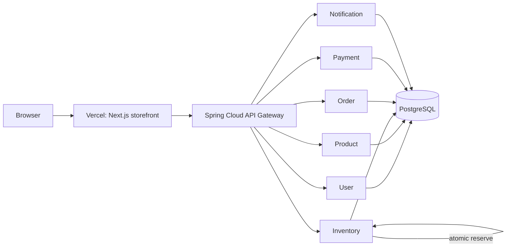

# Distributed Commerce Platform

A runnable e-commerce demo with a Next.js storefront and seven Spring Boot services. It supports account registration/login, product catalog management, inventory reservations, orders, simulated payment/refund, and notification simulation.

## Architecture



## Services

| Service | Port | Responsibility |
|---|---:|---|
| API Gateway | 8080 (published) | Routing, JWT authentication, and ingress |
| User | 8081 (internal) | Registration, login, profile lookup |
| Product | 8082 (internal) | Product create/read/update/soft-delete/search |
| Inventory | 8083 (internal) | Stock adjustment, atomic reservations, release/confirm |
| Order | 8084 (internal) | Create/read/history/cancel and payment confirmation |
| Payment | 8085 (internal) | Idempotent simulated payment and refund |
| Notification | 8086 (internal) | Notification simulation and history |

Only the gateway is exposed to the host; backend ports stay on the Compose network.

PostgreSQL logical databases are `userdb`, `productdb`, `inventorydb`, `orderdb`, `paymentdb`, and `notificationdb`. A service never accesses another service's database.

## Important design decisions

- **Inventory concurrency:** PostgreSQL conditionally decrements stock only when enough units remain. A concurrent H2 test exercises 100 reservations against 10 units.
- **Order flow:** the order service synchronously reads catalog prices, creates an order, and asks inventory to reserve. Payment uses an idempotency key and confirms the order. Failed reservations trigger release/cancel compensation.
- **Payment:** the provider is simulated; no real charge is made.
- **Authentication:** the gateway validates 12-hour HS256 JWTs. Registration/login are public; catalog reads are public; product/stock mutations require the configured administrator. Order, payment, and profile access is owner-checked. Internal reservation/confirmation calls use `INTERNAL_API_TOKEN`.
- **Important scope:** Kafka, Redis caching, outbox publishing, and production-grade saga retries are not implemented in this runnable demo flow.

## Prerequisites

- macOS or Linux
- Java 21
- Maven 3.9+
- Docker Desktop or Docker Engine with Compose v2

## Run locally

```bash
cd distributed-commerce-platform
cp .env.example .env
# Replace the sample JWT_SECRET, INTERNAL_API_TOKEN, and ADMIN_PASSWORD before deployment.

# macOS with Homebrew Java 21
export JAVA_HOME="$(brew --prefix openjdk@21)/libexec/openjdk.jdk/Contents/Home"
export PATH="$JAVA_HOME/bin:$PATH"
java -version
mvn -version
mvn clean package -DskipTests

# On macOS, start Docker Desktop and wait for `docker info` to succeed.
open -a Docker
docker info
docker compose up --build
```

The `java -version` and `mvn -version` output must both report Java 21. If Homebrew Java 21 is not installed, run `brew install openjdk@21` first. Do not ignore a failed `java_home` lookup or continue with an empty `JAVA_HOME`.

On Linux, set `JAVA_HOME` to the installed JDK 21 directory (often `/usr/lib/jvm/java-21-openjdk-amd64`) and add `$JAVA_HOME/bin` to `PATH`. Start and enable Docker Engine using the instructions for your Linux distribution. Run `docker info` and continue only after it succeeds.

Compose starts the storefront and all supporting services together. Open `http://localhost:3000`; the gateway is at `http://localhost:8080`. For frontend-only development, run `cd frontend && cp .env.example .env.local && npm ci && npm run dev` in another terminal.
For local seller access, sign in with `ADMIN_EMAIL` and `ADMIN_PASSWORD` from `.env`. Change these credentials and the JWT/internal secrets before any public deployment.

## Verify

```bash
curl -f http://localhost:8080/actuator/health
docker compose ps
```

Prometheus is available at `http://localhost:9090`, Grafana at `http://localhost:3001`, Kafka UI at `http://localhost:8088`, and PostgreSQL at `localhost:5432`. Grafana's local login is `GRAFANA_USER` / `GRAFANA_PASSWORD` from `.env` (defaults: `admin` / `local-grafana-change-me`). The database user/password are `POSTGRES_USER` / `POSTGRES_PASSWORD` (defaults: `commerce` / `commerce`). Use database `userdb`, `productdb`, `inventorydb`, `orderdb`, `paymentdb`, or `notificationdb`. Example: `psql -h localhost -U commerce -d orderdb`. Kafka is available to host clients at `localhost:9092` and to Compose services at `kafka:9092`; topics in `infrastructure/kafka/topics.txt` are created automatically with three partitions. Kafka UI shows topic and broker state. The services currently execute checkout synchronously; Kafka is provisioned for inspection and development but isn't on the checkout request path yet.

The API endpoint list and copy-paste workflow are in [docs/api-documentation.md](docs/api-documentation.md). To exercise registration, product creation, stock setup, order placement, and simulated payment in one go, run `./scripts/smoke-test.sh` after the stack starts. It needs `curl` and `jq`, and uses the admin credentials from `.env`.

## Deploy the storefront to Vercel

1. Push this project to a Git provider, then import it in Vercel.
2. Set **Root Directory** to `frontend` and framework preset to Next.js.
3. Configure `NEXT_PUBLIC_API_URL` to the public HTTPS URL of the AWS API gateway.
4. Configure the API gateway's `FRONTEND_ORIGIN` to the exact Vercel production URL (and preview URL if needed).
5. Deploy. The storefront will not have working product/order data until the AWS backend is deployed and reachable.

## AWS backend

The Java containers are built for ECS/Fargate. The AWS environment needs a public load balancer for the gateway; private service networking for the six backends; PostgreSQL; and Secrets Manager values for database credentials, `JWT_SECRET`, `INTERNAL_API_TOKEN`, `ADMIN_EMAIL`, and `ADMIN_PASSWORD`. Provide the service endpoint environment variables to the gateway and the order/payment service URLs to the services. Use the same strong `INTERNAL_API_TOKEN` on inventory, order, and payment services. Never use `.env.example` values in a public deployment.

AWS resources are not provisioned automatically by this repository. Do not expose this demo publicly until user authorization, TLS, rate limits, production secrets, and operational monitoring are configured. Deployment will incur AWS charges.

## Tests

```bash
export JAVA_HOME="$(brew --prefix openjdk@21)/libexec/openjdk.jdk/Contents/Home" # macOS with Homebrew
export PATH="$JAVA_HOME/bin:$PATH"
mvn test
```

On Linux set JAVA_HOME to a JDK 21 installation. The Java suite includes the inventory insufficient-stock and concurrent reservation tests. The Next.js production build is `npm run build`; frontend dependencies should be checked with `npm audit`.

## Stop and clean

```bash
docker compose down
docker compose down -v
```

## Known limitations

This is a local demo, not production commerce software. Payments and notifications are simulations. Kafka topics and Redis run locally, but the checkout flow does not publish/consume Kafka events and Redis is not used for catalog caching. Scheduled reservation expiry and automated AWS provisioning are not included. Keep it on disposable test data; do not enter real payment data. Change all local example passwords and secrets before exposing any port beyond your machine.
